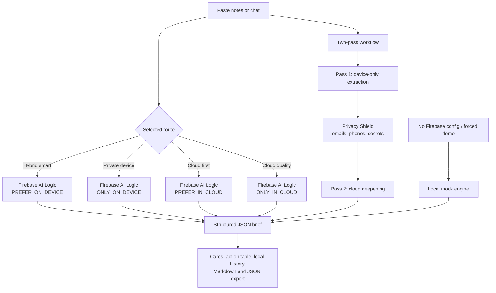

# ClearBrief — Hybrid AI Decision Briefs

**ClearBrief turns messy meetings, chats, and study notes into structured decision briefs—privately on-device first, with optional cloud deepening through Firebase AI Logic.**

Built for **#BuildHybridAI 2026**, targeting **Web / Chrome** and the **Best Web/Chrome App** category while keeping the product eligible for the Grand Prize ladder.

> Current status: **connected to the real Firebase project `clearbrief-hybrid-ai`.** The web config is built into `src/config.js` and was verified locally on 25 Nov 2026 (SDK initializes, AI instance and model objects construct, and Google's Firebase Installations server accepted the project/API key/app ID and issued tokens). Real Gemini generation is the next verification step: it needs an App Check token — a registered debug token for localhost, or reCAPTCHA Enterprise for the production domain — and Chrome Desktop 139+ for Gemini Nano. Demo mode remains available as a fallback. See **§6** for the exact remaining steps.

---

## 1. Concept decision

### Chosen concept: ClearBrief

ClearBrief is a **private-first decision workspace**. A user pastes meeting notes, a team chat, customer conversation, research notes, or study material. ClearBrief returns:

- Executive summary
- Confirmed decisions
- Action items with owner, due date, and priority
- Risks and blockers
- Open questions
- Evidence and notable details
- Recommended next steps
- Study flashcards when the source is study material

Its signature workflow is a **two-pass hybrid process**:

1. **Private pass** — use Gemini Nano on-device to extract the brief without sending the source to the cloud.
2. **Privacy Shield** — mask emails, phone numbers, and common secret formats.
3. **Cloud deepening pass** — only when the user chooses it, send the shielded source and first-pass brief to cloud Gemini through Firebase AI Logic for prioritization, deduplication, and polish.

### Why this won over the other concepts

| Candidate | Strength | Why it was not the primary concept |
|---|---|---|
| Study/writing assistant | Easy to understand; flashcards and rewriting demo well | Narrower impact; hybrid routing is useful, but the privacy/quality tradeoff is less urgent than in workplace conversations |
| Generic meeting/chat summarizer | Broad audience and fast to build | Too easy to look like another summarizer; summaries alone do not expose decisions, owners, risks, or evidence clearly |
| **ClearBrief decision workspace** | Broad workplace impact, structured output, visible action extraction, explicit privacy story, and a memorable two-pass workflow | Requires careful prompt/schema design, but remains feasible as a static web app in 3–4 days |

ClearBrief keeps a study mode as a secondary path instead of making the whole product education-only. The core story is stronger: **sensitive conversations should not have to leave the device just to become useful, but users should still be able to request cloud quality when the work justifies it.**

### Fit to the judging criteria

- **Technological Implementation:** Firebase AI Logic hybrid inference, all four inference modes, structured JSON output for both cloud and on-device paths, App Check, route/source reporting, and a deterministic local mock engine for reliable testing.
- **Design:** A focused workspace with route cards, privacy controls, actual-source metadata, structured action tables, local history, and Markdown/JSON export.
- **Potential Impact:** Meetings and chats are where decisions disappear. ClearBrief helps small teams, students, freelancers, and customer-facing workers recover commitments without adopting a heavy project-management system.
- **Quality of Idea:** The product is not “AI summary, but hybrid.” Its core interaction is the **consent boundary between private local inference and cloud deepening**, made visible and controllable.

---

## 2. Hybrid architecture



### Routing behavior

| UI route | Firebase mode | Privacy behavior in this scaffold |
|---|---|---|
| Hybrid smart | `InferenceMode.PREFER_ON_DEVICE` | Privacy Shield is applied when enabled because the SDK may fall back to cloud |
| Private device | `InferenceMode.ONLY_ON_DEVICE` | Original text is used; the route must fail rather than fall back to cloud |
| Cloud first | `InferenceMode.PREFER_IN_CLOUD` | Privacy Shield is applied when enabled |
| Cloud quality | `InferenceMode.ONLY_IN_CLOUD` | Privacy Shield is applied when enabled |
| Two-pass | Device-only, then cloud-only | First pass uses the original locally; second pass receives the shielded source |

The response metadata displays the SDK-reported `inferenceSource` when available (`ON_DEVICE` or `IN_CLOUD`). Demo mode labels its simulated sources explicitly as `DEMO_ON_DEVICE` or `DEMO_CLOUD`; it never presents mock output as a real Gemini response.

---

## 3. How Firebase AI Logic is used

The integration lives in [`src/firebase-ai.js`](src/firebase-ai.js).

1. Dynamically loads Firebase JS SDK **12.5.0** modules from the official Firebase CDN.
2. Initializes the Firebase web app from [`src/config.js`](src/config.js).
3. Initializes **Firebase App Check** before AI calls:
   - Debug Provider for local development when debug mode is enabled.
   - reCAPTCHA Enterprise when a production site key is configured.
4. Creates the Gemini Developer API backend with `GoogleAIBackend`.
5. Creates a hybrid `GenerativeModel` with `getGenerativeModel` after a user action.
6. Uses one of the official `InferenceMode` values.
7. Calls `model.initializeDeviceModel(progressCallback)` on a user gesture before inference, following Chrome's user-activation requirement.
8. Requests structured output:
   - Cloud: `responseMimeType: "application/json"` plus `responseSchema`.
   - On-device: `promptOptions.responseConstraint` with the same schema shape.
9. Parses and normalizes the result with [`src/brief.js`](src/brief.js), so UI rendering does not depend on unchecked model output.

### Important platform constraints from the official docs

- On-device web inference requires **Chrome Desktop 139+**.
- It uses Chrome's Prompt API / Gemini Nano.
- On-device inference supports **single-turn text generation**, not multi-turn chat. ClearBrief therefore uses independent single-turn prompts and a client-orchestrated second pass.
- During development, Chrome may require enabling:
  `chrome://flags/#prompt-api-for-gemini-nano-multimodal-input`
- The on-device model may need storage space and a first-use download.
- Firebase AI Logic automatically enforces App Check in the guided setup; a debug token must be registered for localhost development.

Official references:

- Hybrid web get-started: https://firebase.google.com/docs/ai-logic/hybrid/web/get-started
- Hybrid structured output: https://firebase.google.com/docs/ai-logic/hybrid/web/generate-structured-output
- App Check debug provider for web: https://firebase.google.com/docs/app-check/web/debug-provider
- App Check with reCAPTCHA Enterprise: https://firebase.google.com/docs/app-check/web/recaptcha-enterprise-provider

---

## 4. Project structure

```text
buildhybridai/
├── index.html                  # Product UI
├── styles.css                  # Responsive visual system
├── server.mjs                  # Dependency-free local static server
├── package.json                # Start and test scripts
├── .env.example                # Values the Firebase setup must collect
├── LICENSE                     # MIT license
├── README.md
├── docs/
│   ├── SETUP_FIREBASE.md       # Exact account-owner setup sequence
│   └── DEMO_SCRIPT.md          # Three-minute English demo script
├── SUBMISSION.md               # Devpost copy draft and checklist
├── src/
│   ├── app.js                  # UI state, workflows, rendering, export
│   ├── brief.js                # JSON parsing and normalization
│   ├── config.js               # Real Firebase web config + runtime overrides
│   ├── firebase-ai.js          # Firebase AI Logic + App Check integration
│   ├── markdown.js             # Markdown export
│   ├── mock-ai.js              # Local demo extraction engine
│   ├── prompts.js              # Single-pass and deepening prompts
│   ├── redaction.js            # Privacy Shield
│   └── storage.js              # Browser-local saved briefs
└── tests/
    └── run-tests.mjs           # Node tests for core logic
```

No backend, database, Firebase Auth, or user account system is required for the hackathon version. Saved briefs stay in browser local storage.

---

## 5. Run locally

### Requirements

- Node.js 20+
- A modern browser; Chrome Desktop 139+ is required only for real on-device inference

### Start

```bash
cd ~/workspace/goals/buildhybridai
npm start
```

Open:

```text
http://127.0.0.1:4173
```

The app opens with a sample launch-sync source. The real Firebase project is
already connected, so once an App Check debug token is registered for
localhost (see §6), **Generate brief** and **Run private → cloud two-pass**
call the real Gemini routes. Until then — or whenever you want a deterministic
run — the UI offers:

- **Force demo mode** to simulate an on-device or cloud pass locally.
- The sample intentionally contains an email address and a fake labeled secret so Privacy Shield masking can be shown.

### Run tests

```bash
npm test
```

Current verified checks include Privacy Shield redaction, mock brief extraction, JSON parsing/normalization, Markdown export, JavaScript syntax checks, and local HTTP delivery of the app shell and modules.

---

## 6. Firebase integration status

**Done — project connected (25 Nov 2026).**

- Firebase project **`clearbrief-hybrid-ai`** created; web app registered in the Firebase Console.
- The real `firebaseConfig` is built into [`src/config.js`](src/config.js) as the default (a runtime `window.CLEARBRIEF_FIREBASE_CONFIG` override still takes precedence). No `measurementId` — Analytics is intentionally disabled.
- Verified locally without a browser:
  - `isFirebaseConfigured()` returns `true`; all config values match the Console.
  - Firebase JS SDK **12.5.0** (the version this app loads) initializes the app and constructs the AI Logic instance + generative model (`gemini-3.5-flash` fallback).
  - A live probe against Google's Firebase Installations endpoint returned **HTTP 200** and issued refresh/auth tokens for this project + API key + app ID — the project is real and accepting this app.
  - `npm test` passes and the local server serves the app shell and all modules with HTTP 200.

**Still remaining — App Check (blocks real Gemini calls):**

Firebase AI Logic enforces App Check, so generation will fail until one of these is in place:

1. **Localhost development — Debug Provider token.**
   - Run the app on `http://127.0.0.1:4173` in Chrome with App Check debug mode enabled (`appCheckDebug: true` via the runtime override, or the debug path in `src/firebase-ai.js`).
   - On first run, Firebase prints a debug token in the browser console.
   - Register that token in **Firebase Console → Security → App Check → Apps → ClearBrief Web → Manage debug tokens**.
   - Never commit the debug token to the repo.
2. **Production — reCAPTCHA Enterprise.**
   - Create a score-based reCAPTCHA Enterprise web key for the production domain.
   - Register it as the App Check provider for the web app in the Console.
   - Put the site key into the runtime config as `recaptchaEnterpriseSiteKey` and make sure debug mode is **off** in production.

**Also still to verify (needs the owner's Chrome Desktop):**

- First real `generateContent` call succeeding (confirms the Gemini Developer API backend is fully enabled for the project and App Check passes end to end).
- Gemini Nano availability + on-device inference in Chrome Desktop 139+ (Prompt API), including the model download on first use.

### Deployment plan

- Deploy the static app to **GitHub Pages from a separate public repo named `clearbrief`** (this working folder stays the development source; the deployment repo is created by the project owner — not yet created).
- The production domain will be the GitHub Pages domain for that repo; register it in reCAPTCHA Enterprise / App Check before announcing the URL.
- Firebase Hosting remains an alternative if GitHub Pages causes App Check domain issues.

### Runtime config alternative

A deployment page can override values by defining this before loading the app module:

```html
<script>
  window.CLEARBRIEF_FIREBASE_CONFIG = {
    apiKey: "...",
    authDomain: "...",
    projectId: "...",
    storageBucket: "...",
    messagingSenderId: "...",
    appId: "...",
    measurementId: "...",
    cloudModel: "gemini-3.5-flash",
    appCheckDebug: false,
    appCheckDebugToken: "",
    recaptchaEnterpriseSiteKey: "..."
  };
</script>
<script type="module" src="src/app.js"></script>
```

For localhost debug mode, set `appCheckDebug: true`. On first run, Firebase prints a debug token in the browser console; the account owner must register that token under Firebase Console → Security → App Check → Apps → Manage debug tokens.

---

## 7. Submission checklist

Full draft copy and field-by-field checklist: [`SUBMISSION.md`](SUBMISSION.md).

### Required before Devpost submission

- [x] Firebase project created (`clearbrief-hybrid-ai`)
- [x] Real Firebase config connected and verified locally (SDK init + live Installations probe, 25 Nov)
- [ ] First real Gemini call succeeds (confirms AI Logic / Gemini Developer API fully enabled)
- [ ] App Check debug flow verified on localhost
- [ ] Production App Check provider configured for the deployed domain
- [ ] Real on-device result verified in Chrome Desktop 139+ where available
- [ ] Real cloud fallback/result verified
- [ ] Two-pass workflow verified with Privacy Shield enabled
- [ ] Public deployment URL works over HTTPS
- [ ] Public GitHub repository contains source, setup instructions, and MIT license
- [ ] Demo video is **3 minutes or less**, in English or with English subtitles
- [ ] Devpost description explicitly explains Firebase AI Logic usage
- [ ] Screenshots show the composer, route selection, structured output, and metadata/source badge
- [ ] Judges' testing instructions include both real-hybrid steps and the reliable demo-mode fallback

### Deadline

**1 December 2026, 05:00 WIB.** Treat 30 November as the internal submission deadline to avoid a last-hour failure.

### Four-day execution plan

| Date | Work |
|---|---|
| 25 Nov | Scaffold, concept, local demo flow, core tests; Firebase project created + config connected and verified |
| 26 Nov | App Check debug token, first real Gemini call |
| 27 Nov | Verify all routes, structured output, two-pass flow, error states |
| 28 Nov | Deploy HTTPS URL, production App Check, judge instructions, screenshots |
| 29 Nov | Record and edit the ≤3-minute demo video |
| 30 Nov | Final QA and submit on Devpost |
| 1 Dec 05:00 WIB | Official deadline / emergency buffer only |

---

## 8. Privacy and security notes

- Private-device mode is the only route that promises no cloud fallback.
- Hybrid mode can fall back to the cloud, so the UI and code treat Privacy Shield as the safe default.
- Privacy Shield is a client-side masking aid, not a compliance guarantee. It currently targets emails, phone-like numbers, URL credentials, common token formats, and labeled password/API-key values.
- Saved briefs are stored only in the browser's local storage.
- App Check protects Firebase AI Logic calls from unattributed traffic; it does not replace product-level privacy controls.
- Never publish a debug token or set debug mode in production.

---

## 9. Known limitations and next steps

### Current scaffold limitations

- The Firebase project and web config are connected and verified at the SDK/installation level, but a real Gemini generation call has not been verified yet — it is gated on App Check (debug token for localhost, reCAPTCHA Enterprise for production) and, for on-device routes, on the owner's Chrome Desktop environment.
- The local mock engine is heuristic and intended for product-flow testing, not as a substitute for Gemini in the final submission.
- On-device availability depends on the judge's Chrome version, flags, hardware, storage, and model-download state. The submission should therefore lead judges through demo mode first, then real hybrid mode.
- Privacy Shield does not reliably detect every name, address, financial identifier, or organization-specific secret.
- There is no account sync, collaboration, calendar integration, or task-manager export yet.

### Strong next features after the hackathon

- One-click export to Google Tasks, Notion, and GitHub Issues
- Source-span citations for every decision and action
- User-managed custom redaction rules
- Team workspaces with end-to-end encrypted shared briefs
- Follow-up reminders generated from due dates
- Domain templates for sales calls, lectures, support conversations, and standups
